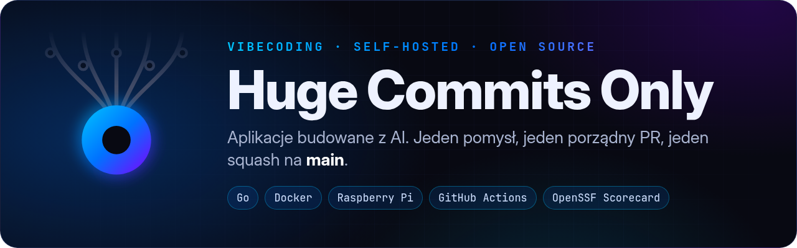
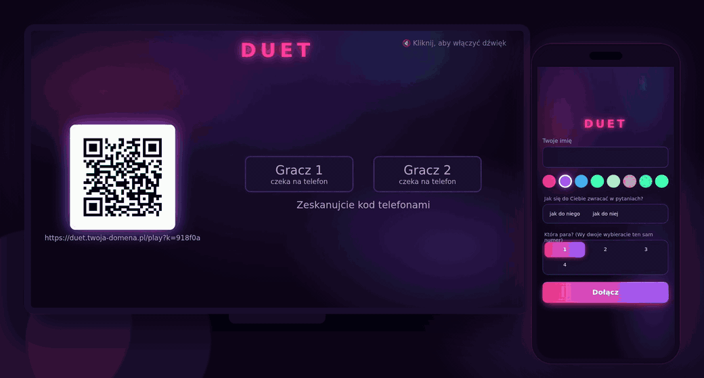
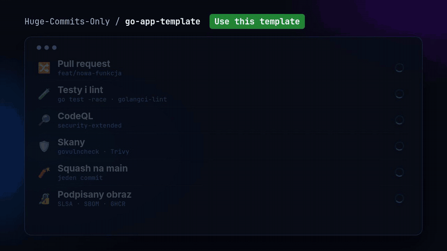
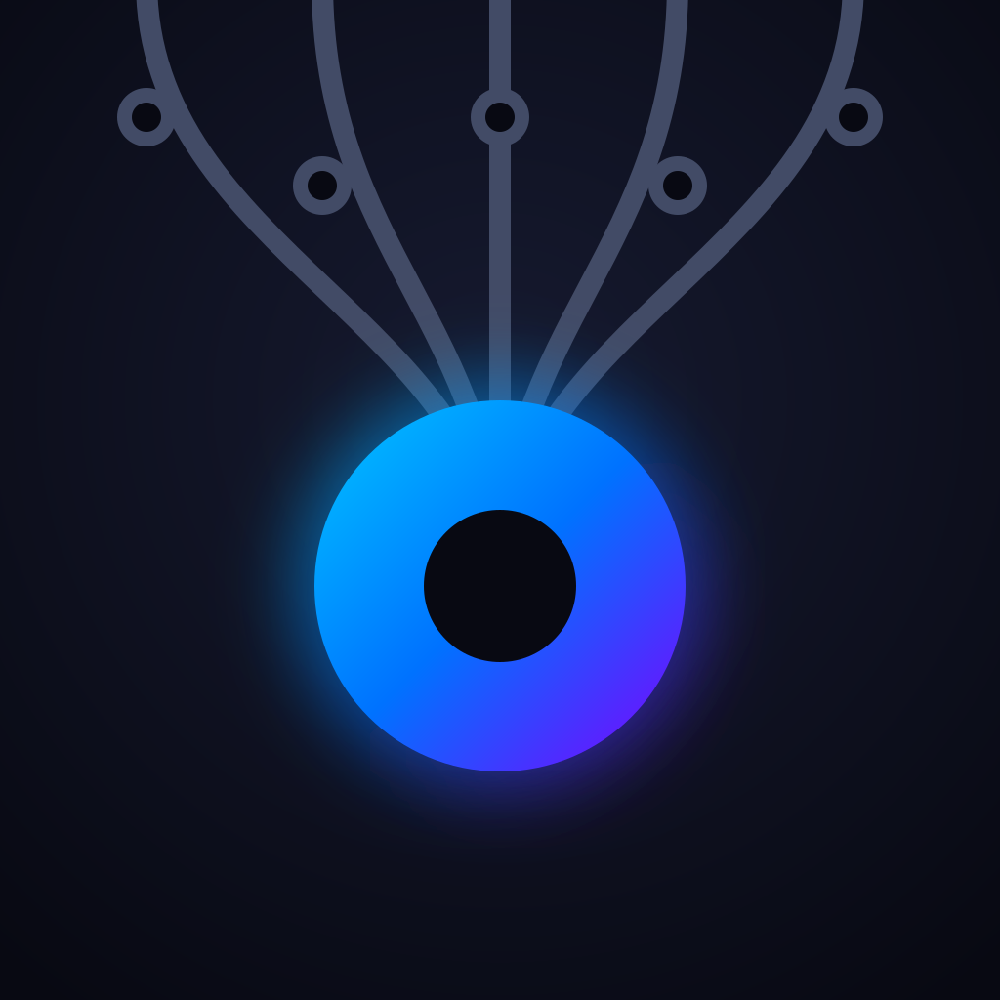

 

**[🌐 huge-commits-only.github.io](https://huge-commits-only.github.io/)** · **[🗺️ Roadmapa](https://github.com/orgs/Huge-Commits-Only/projects/1)**

 

## 🚀 Projekty

<table>
<tr>
<td width="55%"></td>
<td width="45%" valign="top">
<h3>💞 <a href="https://github.com/Huge-Commits-Only/duet">duet</a></h3>
Gry i quizy dla par. Projektor pokazuje grę, telefony są pilotami — wejście przez kod QR, bez aplikacji i kont.
  
🎮 13 trybów · 👥 do 4 par · 🏠 bez chmury 
🎯 Go · 🐳 obraz <code>scratch</code> · ⚡ ok. 25 MB RAM
  

</td>
</tr>
<tr>
<td width="55%"></td>
<td width="45%" valign="top">
<h3>🧨 <a href="https://github.com/Huge-Commits-Only/go-app-template">go-app-template</a></h3>
Nowy projekt w minutę. <b>Use this template</b> i masz aplikację w Go z testami, obrazem dla Raspberry Pi i kompletem CI — na zielono od pierwszego commita.
  
🧪 testy i lint · 🔎 CodeQL · 🛡️ Trivy 
🔏 podpisane obrazy (SLSA) · 🤖 Dependabot
</td>
</tr>
</table>

 

## 🧭 Jak tu pracujemy

<table>
<tr>
<td width="50%" valign="top"><h3>🤖 Vibecoding z głową</h3>AI pisze kod, człowiek decyduje. Review, testy i skany pilnują, żeby do <code>main</code> trafiało tylko to, co działa.</td>
<td width="50%" valign="top"><h3>🧨 Huge commits only</h3>Jedna zmiana to jeden porządny PR, scalany jako jeden squash commit. Historia czyta się jak lista funkcji.</td>
</tr>
<tr>
<td valign="top"><h3>🏠 Self-hosted</h3>Wszystko działa w homelabie na Raspberry Pi (arm64). Bez chmury, bez kont, dane zostają w domu.</td>
<td valign="top"><h3>⚡ Lekko</h3>Minimum zależności, obrazy <code>scratch</code> i distroless, kilkanaście–kilkadziesiąt MB RAM.</td>
</tr>
</table>

 

## 🛡️ Bezpieczeństwo
- 🧪 Testy, fuzzing i testy w prawdziwej przeglądarce przy każdym PR.
- 🔎 CodeQL, govulncheck, gosec i Trivy; nowy poważny alert blokuje merge.
- 📌 Akcje GitHub tylko z listy dozwolonych i przypięte do SHA, obrazy bazowe przypięte do skrótu.
- 🔏 Obrazy z podpisaną atestacją pochodzenia (SLSA) i SBOM; wynik [OpenSSF Scorecard](https://scorecard.dev/viewer/?uri=github.com/Huge-Commits-Only/duet) co tydzień.
- 🤐 Secret scanning z blokadą pushy, Dependabot, prywatne zgłaszanie podatności. Znalazłeś podatność? Nie zakładaj issue — **Security → Report a vulnerability** ([SECURITY.md](https://github.com/Huge-Commits-Only/.github/blob/main/SECURITY.md)).

 
Jeden pomysł · jeden porządny PR · jeden squash na <code>main</code>

